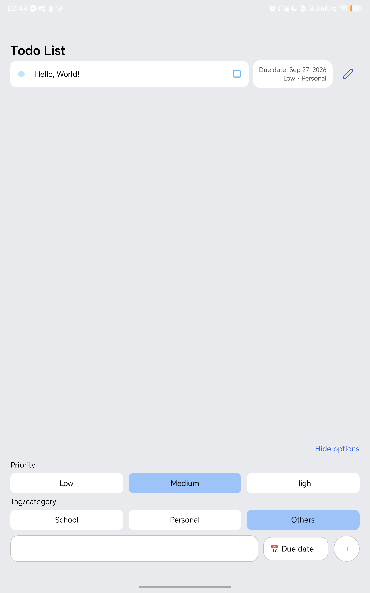
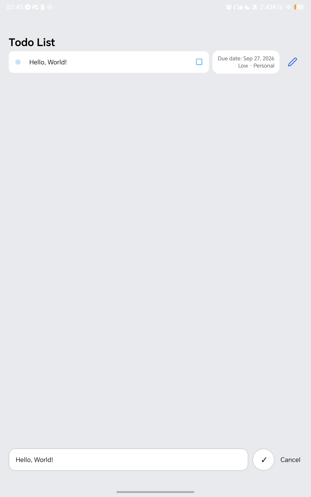

# CMSC 128 Lab 1 — Todo List CRUD

A React Native task manager with an Express API. Users create an account, sign in, and manage their own tasks. Each task has a title, due date, priority, category, and completion flag. The mobile UI currently edits titles; the API also supports updating the other fields.

The server stores accounts and tasks in SQLite using `better-sqlite3`. Passwords are hashed with bcrypt at cost 12. Authentication uses one-hour HS256 JWTs backed by database sessions, so signing out revokes the current token immediately. Every task query includes the authenticated user's ID. Tokens stay in app memory, and restarting the app requires signing in again. Task operations require a connection to the API; this version has no offline queue or automatic synchronization.

## Run the backend

Use Node.js 22.13 or newer. Install the backend dependencies separately from the mobile dependencies:

```bash
npm ci --prefix backend
cp backend/.env.example backend/.env
node -e "console.log(require('node:crypto').randomBytes(32).toString('hex'))"
```

Paste the generated value into `JWT_SECRET` in `backend/.env`, then start the API:

```bash
npm start --prefix backend
```

The server reads `backend/.env` regardless of the working directory. It listens on port 3000 by default and refuses to start without a secret of at least 32 bytes. Set `PORT` to change the port. `npm run dev --prefix backend` starts nodemon for development.

The database defaults to `backend/data.sqlite` and is created automatically with a versioned schema. `DB_PATH` can point to another database file in an existing directory. Use a persistent disk for deployment and keep `JWT_SECRET` stable across restarts. Database files, WAL files, and the backend `.env` are ignored by Git. Only the server needs the signing secret; never put it in an `EXPO_PUBLIC_` variable.

For a browser client, set `CORS_ORIGINS` to a comma-separated list of allowed origins, for example `http://localhost:8081`. Native requests do not require CORS permission. Authentication endpoints allow 20 requests per IP per 15 minutes. This limit is local to one server process; proxy trust is disabled. A deployment behind a proxy or using multiple processes should configure rate limiting at its trusted ingress. Use HTTPS for a hosted API.

## Run the mobile app

Install dependencies from the repository root:

```bash
npm ci
cp .env.example .env.local
```

Set `EXPO_PUBLIC_API_BASE_URL` in `.env.local` to a URL reachable from the device:

| Target | Example URL |
| --- | --- |
| Android emulator | `http://10.0.2.2:3000` |
| Physical device on the same network | `http://<computer-LAN-IPv4>:3000` |
| USB device after `adb reverse tcp:3000 tcp:3000` | `http://localhost:3000` |
| Hosted backend | `https://<your-api-host>` |

Restart Metro after changing environment variables. A phone's `localhost` points to the phone, unless an ADB reverse is configured.

Android development requires JDK 17, an Android SDK, and a running emulator or connected device listed by `adb devices`. Set `JAVA_HOME`, `ANDROID_HOME`, and add the SDK platform tools to `PATH`, then run:

```bash
npm run android
```

For subsequent sessions with the native app already installed:

```bash
npm start
```

Keep Expo, React Native, and native module versions aligned when installing mobile dependencies. The date picker requires a supported native Android/iOS build; the full CRUD screen is not verified on web.

Sign up with a nonempty username, a valid email address, and a password of at least eight characters and at most 72 UTF-8 bytes. Emails are normalized to lowercase and must be unique, as must usernames. After signing in, create a task with a title and date, edit its title with the pencil button, or confirm its deletion. **UNDO** restores the most recently deleted task as a new server record. The banner lasts three seconds; a failed restoration can be retried while the screen stays open. **Sign out** revokes the current session. Network and validation errors appear in the UI.

## API

Requests and responses use JSON. Protected requests send `Authorization: Bearer <token>`. Signup and login return `{ token, user: { id, username, email } }`. Error responses return `{ error: "message" }`.

| Method | Path | Behavior |
| --- | --- | --- |
| GET | `/` | Health response `{ "status": "ok" }` |
| POST | `/auth/signup` | Create account using `{ username, email, password }`; return session (201) |
| POST | `/auth/login` | Verify `{ email, password }`; return session |
| GET | `/auth/me` | Return authenticated profile as `{ user }` |
| POST | `/auth/logout` | Revoke current session (204) |
| GET | `/todos` | Return current account's tasks as `{ todos }`, newest first |
| POST | `/todos` | Create a task and return `{ todo }` (201) |
| PATCH | `/todos/:id` | Update supplied task fields and return `{ todo }` |
| DELETE | `/todos/:id` | Delete an owned task (204) |

Task creation requires `title`, `dueDate`, `priority`, and `category`. `completed` defaults to `0`. Updates accept one or more of those fields plus `completed`. Titles contain 1–200 characters after trimming. Priorities are `Low`, `Medium`, or `High`; categories are `School`, `Personal`, or `Others`; completion is integer `0` or `1`. Due dates are canonical ISO timestamps, such as `2026-10-25T00:00:00.000Z`. The mobile form converts the selected local calendar date to an ISO timestamp.

Unknown request fields are rejected, including client-supplied ownership IDs. The server assigns ownership from the verified session. Requests for another account's task return 404. Missing, expired, tampered, or revoked sessions return 401. Duplicate usernames/emails return 409, malformed input returns 400, oversized JSON returns 413, and excessive authentication attempts return 429.

## Existing installations and database changes

The previous app stored plaintext passwords, shared tasks, and a profile marker in the device's `tasks.db`. This implementation leaves that file untouched but no longer reads it. The profile marker cannot sign a user in, and legacy rows are never sent to the API. Create a new server account. Shared legacy tasks have no recorded owner, so automatically assigning them to the next account would expose data. Any future import must explicitly choose which tasks belong to which account.

The old device email-column migration is retired with the local authentication code. The server creates its own schema, with unique normalized emails from the first version, rather than trying to merge potentially duplicate device identities. `PRAGMA user_version` tracks server schema changes, and the server refuses a database from a newer schema version. Existing unversioned tables are not silently rewritten.

## Implementation and validation

`backend/server.js` loads configuration and starts the listener. `backend/app.js` defines HTTP routes, request limits, and JSON errors. `backend/auth.js` signs and verifies sessions. `backend/db.js` creates the database schema, and `backend/validation.js` validates request fields. The frontend client is `src/services/api.ts`; `src/db/database.ts` keeps the task functions used by the UI and sends their operations to the API.

Run backend integration tests:

```bash
npm test --prefix backend
```

The tests open temporary loopback ports and isolated SQLite databases. They cover password hashing, credential validation, normalized uniqueness, authentication, cross-account task isolation, task validation, logout revocation, expired/tampered tokens, request limits, CORS, and persistence across database reopen. They do not use the development database or send email.

With the root development dependencies installed, run the frontend API client tests:

```bash
node --test scripts/test-api-client.cjs
```

These exercise the actual TypeScript client with a mocked fetch boundary, including authentication transitions and stale responses. They do not prove native routing, layout, date selection, or connectivity from a handset.

## Screenshots

These images show the earlier Android task UI, before the API/authentication changes. They are not evidence of a device test of the new backend.

| Task list | Edit form |
| --- | --- |
|  |  |
